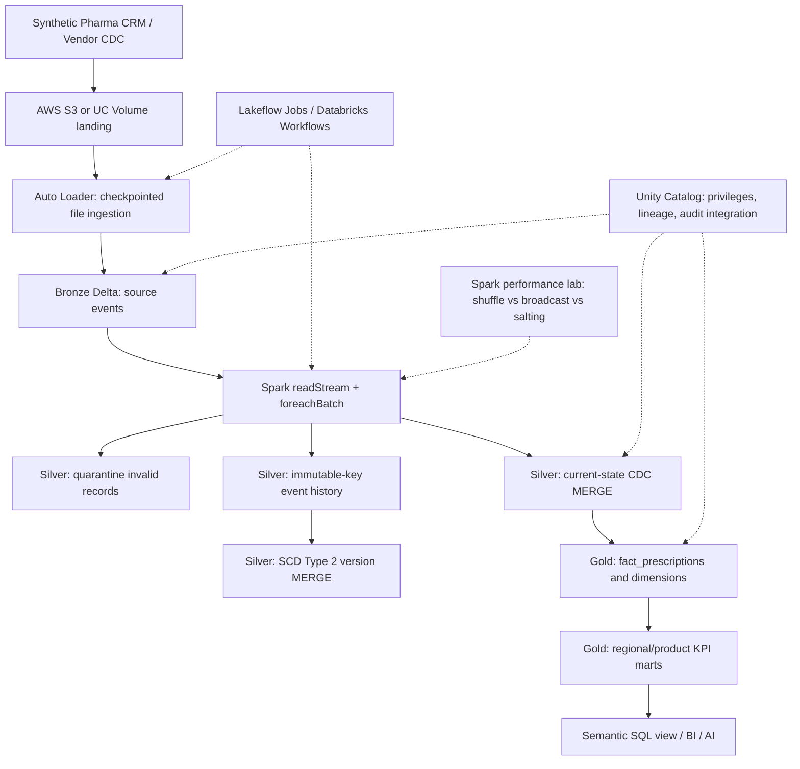

# Pharma Enterprise Lakehouse — PySpark + Delta CDC (v2)

**A GitHub-ready portfolio project demonstrating AWS/Databricks lakehouse engineering with 100% synthetic pharmaceutical commercial data.** No affiliation with Eisai; no PHI, real patient records, production company data or proprietary code.

[](.github/workflows/ci.yml)  

> **Verification — important:** The dependency-free reference model's unit tests run locally, and all source code can be syntax-checked. This project also contains **real PySpark + Delta Lake code**, a Spark/Delta integration test suite and a performance lab, but this archive was produced without Spark/Delta packages or JVM jars available to execute in the build environment. Run the integration test suite in GitHub Actions or a compatible Spark/Databricks environment before claiming those tests passed. No AWS/Databricks deployment, 5 TB benchmark, validated regulatory audit process or GxP validation is claimed.

## What changed in v2

| Capability | v1 | v2 |
|---|---|---|
| Bronze ingestion | Databricks Auto Loader | Preserved (file/checkpoint incremental) |
| Silver processing | Full scan of Bronze on each run | **Incremental** `readStream.table` + `foreachBatch` |
| Current-state CDC | Delta MERGE | **PySpark modular MERGE** with source sequence guard and logical deletes |
| Source-event history | Overwrite | **Append-only-by-event-id** Delta MERGE |
| Historical state | Source-event history only | **SCD Type 2** versions with effective dates and delete tombstones |
| Data quality | Quarantine overwrite | **Idempotent quarantine** with stable record digest |
| Spark performance | Documentation | **Executable experiment:** shuffle, broadcast, skew salting + correctness checks |
| Automated checks | Standard library | Reference tests + **Spark/Delta integration** CI job |

## System design



**Design choices:** Event sequence, rather than arrival timestamp, determines CDC correctness. Source events and type-2 business state have different grains. Bronze has its own file-ingestion checkpoint; Silver has a separate streaming checkpoint. Each Delta MERGE is atomic per table, but the chain of Silver table writes is **not** one cross-table transaction; full-batch reprocessing makes retries converge.

## Run in minutes (without Spark)

Requires Python 3.10+. This is the tested **pure-Python reference**, not PySpark:

```bash
PYTHONPATH=src python -m unittest discover -s tests -p test_reference.py -v
PYTHONPATH=src python -m pharma_demo.cli --records 1000 --output demo_outputs
```

Baseline synthetic 1,000-prescription reference example: 980 active, 20 logically deleted, 1 quarantined event, two duplicate event IDs in the input. `sample_outputs/` contains reference artifacts.

## Run the real PySpark / Delta Lake implementation

On a machine with Python 3.11 or 3.12, Java 17, PyPI and Maven access:

```bash
python3 -m venv .venv
source .venv/bin/activate
pip install -e '.[spark]'
python -m unittest discover -s tests -p test_spark_pipeline.py -v
python -m pharma_demo.spark_demo --rows 200 --output spark_outputs
```

The last command uses `SparkSession`, Delta JVM integration and **physical Delta table files** locally. It processes both synthetic CDC batches, simulates a failure retry by replaying batch 2, and asserts that row counts and business totals remain identical. On the first run, delta-spark may need to download JARs from Maven Central. Output is stored outside version-controlled files in `spark_outputs/`.

**Databricks**: A workspace with Unity Catalog is needed. Copy or clone the **entire** repository to a Databricks Git folder (not just individual notebooks), open `notebooks/00_setup.py`, then run notebooks 01 → 05. Set `batch_number=2` in notebook 01 for a second incremental run, and rerun notebooks 02 → 05. Notebook 03 imports the modular PySpark logic from `src/pharma_demo/`. See [Databricks and local runbook](docs/SPARK_LAB.md).

## Performance optimization lab

```bash
python -m pharma_demo.performance --rows 200000 --keys 1000 --hot-pct 65 --salts 8
```

This executes three **real Spark joins** on the same synthetic skewed facts and dimension: a shuffle-join baseline, a broadcast of a **small** dimension, and a salted hot-key join. Each computes the same weighted business aggregate to catch incorrect joins. The program prints `EXPLAIN FORMATTED` plans and writes observed timings to `reports/performance_benchmark.json`; timings are **not populated or asserted in this archive**. You can also run `notebooks/06_performance_lab.py` and collect Spark UI screenshots once a workspace is available.

**Never imply that a 100 GB dimension should automatically be broadcast.** That would usually be inappropriate. For a 5 TB × 100 GB join, inspect Spark UI/task skew/shuffle/spill, filter and project early, enable AQE, validate join cardinality and try controlled salting only when needed.

## Repository structure

```text
pharma-enterprise-lakehouse-v2/
├── .github/workflows/ci.yml         # Ref tests + required Spark/Delta integration checks
├── databricks.yml                   # Orchestrated Medallion pipeline example
├── notebooks/
│   ├── 00_setup.py                  # Unity Catalog schemas/landing volume
│   ├── 01_generate_source.py        # Synthetic incremental pharma CDC events
│   ├── 02_bronze_autoloader.py      # Checkpointed file ingestion
│   ├── 03_silver_cdc.py             # Incremental streaming + Delta MERGE
│   ├── 04_gold_marts.py             # Star schema and SQL KPIs
│   ├── 05_validate.py               # Release / data-quality gate
│   └── 06_performance_lab.py        # Join-plan and skew demonstration
├── src/pharma_demo/
│   ├── synthetic.py                 # Deterministic source generator
│   ├── reference.py                 # Stdlib correctness oracle
│   ├── spark_pipeline.py            # Reusable Spark CDC, quarantine, SCD2
│   ├── spark_demo.py                # Real local Spark+Delta execution entry point
│   └── performance.py               # Spark benchmark driver and skew salting
├── tests/test_reference.py         # Dependency-free tests
├── tests/test_spark_pipeline.py     # Real Spark+Delta integration tests
├── sql/                            # Example analytics/governance SQL
├── docs/SPARK_LAB.md               # Hands-on exercise and screenshot checklist
├── docs/INTERVIEW_TALK_TRACK.md    # Interview script and probing questions
└── docs/ARCHITECTURE.md            # Assumptions, limits and productionization
```

## What this demonstrates — and what it does not

**Actually implemented in code:** PySpark DataFrame transformations, deterministic event deduplication, data-quality quarantine, incremental Delta CDC MERGE, replay protection, source-event history, SCD2 effective intervals, Gold metrics, Spark performance join strategies, SQL and CI configuration.

**Still required for production:** Live workspace deployment/tests, AWS IAM/KMS/network setup, private networking and regional residency review, Informatica integration, MDM, formal Data Vault modeling, Delta Change Data Feed incremental Gold propagation, failure injection, GxP/21 CFR Part 11 assessment, automated cloud governance and realistic 5–20 TB scale testing. Synthetic data only.

